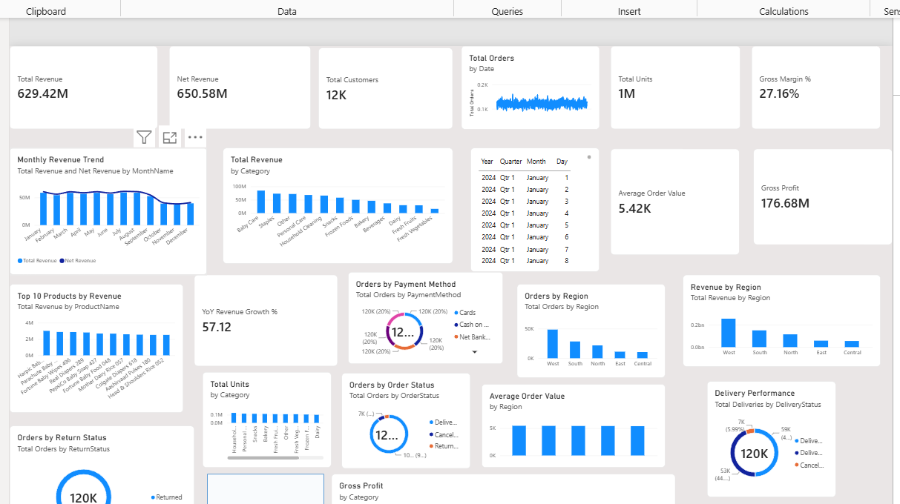
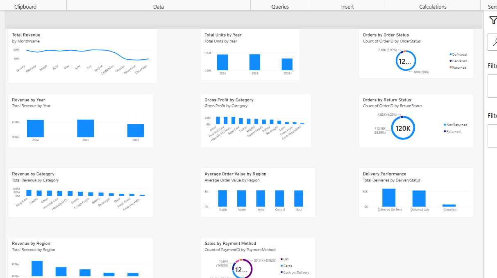
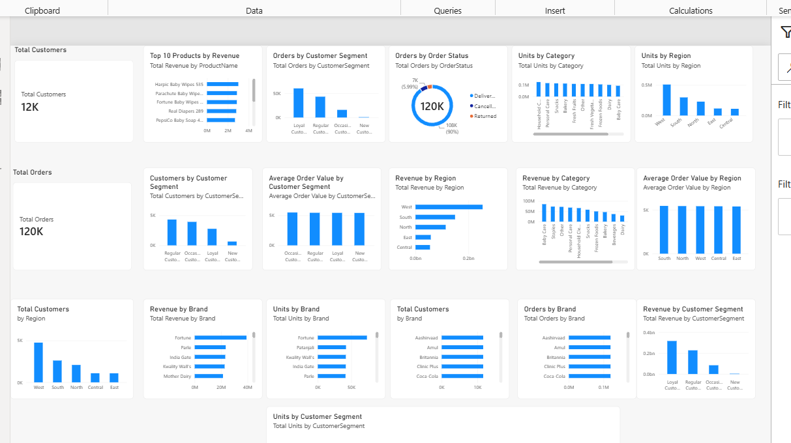

# 🛒 QUICKCART
### E-Commerce / Grocery Sales & Customer Intelligence Platform

<p align="center">

  **An End-to-End E-Commerce Analytics & Business Intelligence Project**

  Python | MySQL | Pandas | NumPy | SQL | Power BI | DAX

</p>

---

## 📌 Project Overview

QuickCart is an end-to-end E-Commerce and Grocery Sales Analytics platform built using Python, MySQL, Pandas, NumPy, Matplotlib, SQL, and Power BI.

The project simulates a real-world quick-commerce business environment and analyzes customer behavior, product sales, revenue, orders, payments, returns, deliveries, inventory, and regional performance.

It includes automated data generation, data cleaning, data validation, database integration, SQL analysis, analytical exports, and an interactive Power BI dashboard for business intelligence and decision-making.

---

## 🛠️ Technologies Used

| Technology | Purpose |
|---|---|
| Python | Data processing and automation |
| Pandas | Data manipulation and analysis |
| NumPy | Numerical operations |
| Matplotlib | Data visualization |
| MySQL | Relational database |
| SQL | Business analysis |
| Power BI | Interactive dashboards |
| DAX | Business KPI calculations |
| Git & GitHub | Version control |

---

## 🚀 Key Features

- Automated E-Commerce data generation
- Data cleaning and preprocessing
- Data validation and quality checks
- MySQL database integration
- SQL-based business analysis
- Customer behavior analysis
- Product and category sales analysis
- Revenue and profit analysis
- Regional sales analysis
- Payment method analysis
- Order status analysis
- Returns and cancellations analysis
- Delivery performance analysis
- Inventory analysis
- Interactive Power BI dashboard
- Business KPI tracking
- DAX measures and calculations
- Power BI-ready star schema
- CSV-based analytical datasets

---

## 📊 Dataset Overview

QuickCart uses a large synthetic E-Commerce dataset designed to simulate real-world business operations.

| Dataset | Records |
|---|---:|
| Customers | 12,000 |
| Products | 750 |
| Orders | 120,000 |
| Order Items | 358,731* |
| Locations | 22 |
| Date Range | 2024–2026 |

*Order item count should be verified against the final generated dataset.*

The analytical model includes dimension and fact tables for:

- Customers
- Products
- Locations
- Dates
- Orders
- Order Items
- Payments
- Returns
- Deliveries
- Inventory

---

## 📈 Business KPIs

The project analyzes important business performance indicators.

### Revenue & Profitability
- Total Revenue
- Net Revenue
- Gross Profit
- Gross Margin
- Average Order Value

### Sales Performance
- Total Orders
- Total Units Sold
- Revenue by Category
- Revenue by Product
- Monthly and Yearly Revenue Trends

### Customer Intelligence
- Total Customers
- Customer Segments
- Revenue by Customer Segment
- Customer Purchase Behavior

### Operations
- Delivered Orders
- Cancelled Orders
- Returned Orders
- Delivery Performance
- Inventory Analysis

### Payment Analytics
- Revenue by Payment Method
- Payment Status Analysis

---

## 📊 Power BI Dashboard

QuickCart includes an interactive Power BI dashboard with three analytical pages.

### 1. Executive Overview

Provides a high-level view of overall business performance.

Key insights:

- Revenue
- Gross Profit
- Gross Margin
- Orders
- Customers
- Units Sold
- Order Status
- Return Status
- Monthly and Yearly Trends



### 2. Sales & Revenue Analysis

Provides detailed sales and revenue performance analysis.

Key insights:

- Revenue Trends
- Units Sold
- Revenue by Category
- Revenue by Region
- Revenue by Payment Method
- Profitability Analysis
- Customer Segment Performance



### 3. Customer & Product Analysis

Focuses on customer intelligence and product performance.

Key insights:

- Top Products by Revenue
- Customer Segments
- Revenue by Customer Segment
- Average Order Value
- Product and Category Performance
- Brand Performance
- Regional Customer Analysis



---

## 📁 Project Structure

```text
QuickCart/
│
├── data/
│   ├── raw/
│   └── processed/
│
├── data_generator.py
├── data_cleaning.py
├── data_validation.py
├── csv_quality_checker.py
│
├── database.py
├── sql_analysis.py
├── check_payment.py
│
├── project_health_check.py
├── powerbi_setup.py
├── logger_config.py
│
├── main.py
├── main1.py
├── config.py
├── requirements.txt
│
├── quickcart_powerbi_page_1.png
├── quickcart_powerbi_page_2.png
├── quickcart_powerbi_page_3.png
│
├── README.md
└── LICENSE
```

---

## ⚙️ Installation & Setup

### 1. Clone the Repository

```bash
git clone https://github.com/harshvardhansawatar14-spe/QuickCart.git

cd QuickCart
```

### 2. Create a Virtual Environment

```bash
python -m venv venv
```

Activate on Windows:

```powershell
venv\Scripts\activate
```

### 3. Install Dependencies

```bash
pip install -r requirements.txt
```

### 4. Configure MySQL

Create the MySQL database:

```sql
CREATE DATABASE quickcart_ecommerce;
```

Configure your database credentials according to the settings supported by `config.py` and `database.py`.

Do not upload actual passwords or secret credentials to GitHub.

### 5. Run the Project

```bash
python main.py
```

Follow the configured workflow to generate, process, validate, and analyze the E-Commerce data.

---

## 🔄 Data Analytics Pipeline

QuickCart follows an end-to-end analytics workflow.

```text
Data Generation
      |
      v
Data Cleaning
      |
      v
Data Validation
      |
      v
MySQL Database
      |
      v
SQL Business Analysis
      |
      v
CSV / Analytical Exports
      |
      v
Power BI Data Model
      |
      v
DAX Measures
      |
      v
Interactive Dashboard
```

---

## 🎯 Project Objectives

- Simulate real-world E-Commerce operations.
- Build an automated data processing pipeline.
- Improve data quality and consistency.
- Perform SQL-based business analysis.
- Understand customer and product performance.
- Develop interactive business intelligence dashboards.
- Generate actionable business insights.

---

## 💡 Business Value

QuickCart demonstrates how raw E-Commerce data can be transformed into meaningful business intelligence.

The platform helps analyze:

- Which products generate the highest revenue?
- Which regions contribute most to sales?
- How do customers behave across segments?
- Which payment methods are most commonly used?
- How efficiently are orders delivered?
- What are the patterns in returns and cancellations?
- How can inventory performance be monitored?

---

## 👨‍💻 Author

**Harsh Vardhan Sawatar**

B.Sc. Computer Science

Aspiring Python Developer | Data Analyst

**Technical Skills:**

Python | SQL | MySQL | Pandas | NumPy | Matplotlib | Power BI

---

## ⭐ Support

If you find this project useful or interesting, consider giving this repository a ⭐ on GitHub.

**QuickCart – Turning E-Commerce Data into Business Insights.**
